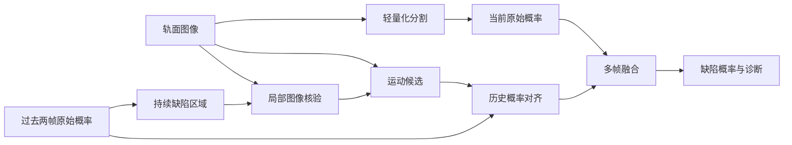
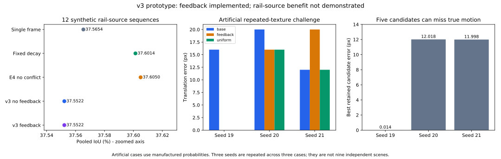

# Rail Surface Motion

**钢轨表面缺陷检测 · 运动补偿 · 多帧融合**

**v1.0.0 · 钢轨运动补偿研究工具**

本项目面向移动采集条件下的钢轨表面缺陷检测，研究轻量化分割、帧间配准与历史缺陷证据的协同使用。项目提供MATLAB分割基线与训练流程，以及可接入逐帧概率的Python运动反馈原型。

v1.0.0 提供论文主对照 S / U / A / B / v4 的统一入口。输入连续轨面 RGB 帧和分割前景概率，可获得五组概率图、统一判别阈值和逐帧估计位移。公开实验覆盖受控几何、来源级检测差异和采样间隔。[保留来源与采样实验](docs/heldout_motion_sampling_results.md) · [准确几何对齐消融](docs/heldout_exact_alignment_results.md)

[快速开始](docs/START_HERE.md) · [方法与实验](docs/algorithm_v3_prototype_results.md) · [研究进展](docs/PROGRESS.md) · [更新记录](CHANGELOG.md)

## 项目特点

- **轻量分割基线**：小型U-Net与MobileNetV2–DeepLabv3+，包含训练、验证和三种子比较。
- **运动补偿**：NCC配准、可选位移先验，以及分离的亚像素运动假设。
- **历史证据核验**：利用过去帧的持续缺陷响应确定图像匹配区域，研究运动反馈与融合可靠性。
- **模块化接口**：`MotionFeedback.step`接收RGB和原始分割概率，输出不同反馈/融合分支的概率及诊断信息。
- **可复现实验**：固定分区、参数与评价口径，配套人工场景、对照方法和结果CSV。

## 方法概览



v3采用三帧因果窗口。历史缺陷区域引导图像核验，运动估计用于对齐原始概率；反馈结果与融合结果分别比较，便于识别各模块的作用。

## 快速开始

使用 Python 3.12 运行 **S / U / A / B / v4**。安装依赖后可直接运行内置示例，或提供自己的连续 RGB 帧和前端概率。输入数组、输出键与保留来源报告见[主对照运行指南](docs/START_HERE.md#论文主对照-s--u--a--b--v4)。

```bash
git clone https://github.com/LevinJustus/rail-surface-motion-research.git
cd rail-surface-motion-research
python -m pip install -r requirements-conditional.txt
python tools/run_fusion_comparison.py --demo --output runs/fusion_demo.npz
```

下方为历史运动反馈原型的运行方式。

```bash
python -m pip install -r requirements-v3.txt

# 运行算法行为检查
python tools/run_v3_feedback_batch.py --contracts-only --out runs/v3_contracts_demo

# 运行重复纹理、短时漏检与错误历史的人工场景
python tools/run_v3_feedback_challenge.py --out runs/v3_challenge_demo
```

人工场景脚本构造测试输入并保存结果，输出写入`runs/`。更换输出目录名即可保留多次运行记录。接入视频概率、MATLAB训练与数据准备见[快速开始](docs/START_HERE.md)。

## 实验结果

单帧基线采用1396张训练图、400张验证图，结果为三个种子的均值±样本标准差；IoU、Dice为缺陷前景像素指标。

| 模型 | 参数量 | IoU | Dice | Precision | Recall |
|---|---:|---:|---:|---:|---:|
| 小型U-Net | 482050 | 0.4524±0.0364 | 0.6224±0.0342 | 0.5451±0.0973 | 0.7464±0.0713 |
| MobileNetV2–DeepLabv3+ | 2740082 | 0.4408±0.0200 | 0.6117±0.0194 | 0.6314±0.0189 | 0.5933±0.0214 |

完整设置和best/last结果见[单帧基线](docs/step10_full_results.md)与[模型对照](docs/step11_mature_results.md)。

保留来源评价覆盖44个来源代理组和132条受控序列。组合退化下，视觉配准将平均端点误差由约8.32像素降至0.55像素。DeepLab的对齐等权在自然与人工来源组中的前景IoU分别较单帧提高0.351和0.700个百分点。历史反馈原型另在重复纹理和短时漏检场景下比较运动选择与融合行为，逐分支结果见[v3实验报告](docs/algorithm_v3_prototype_results.md)。



[图表来源与绘图源码](docs/FIGURES.md)

## 真实视频开发验证

实拍开发验证使用三个片段和固定的 MobileNetV2–DeepLabv3+ 概率，比较单帧、基础配准融合和条件纠错。一个片段隔帧处理时，89条相邻边中有13条触及搜索边界并回退至单帧。实验记录了真实移动画面中的预测响应和回退行为。[连续视频对照](docs/real_video_development.md)

## 项目结构

```text
python/          运动反馈与概率融合接口
matlab/          分割网络、训练、配准与受控序列生成
tools/           数据准备、评价与结果绘图
configs/         模型、训练和运动算法配置
data/            数据来源、文件清单与固定分区
docs/            方法说明、实验报告和研究进展
results/         基线比较、阈值诊断与配准结果
```

## 研究路线

下一阶段采用带确认标签的独立连续轨段，以相同误报负担下的缺陷事件召回比较单帧、零位移等权和对齐等权。路线与报告索引见[研究进展](docs/PROGRESS.md)。

## 数据与使用

[MIT 许可证](LICENSE)适用于本项目自行编写的代码和配套文档。第三方数据、标注、权重与软件适用其各自条款，详见[第三方材料声明](THIRD_PARTY_NOTICES.md)。

数据来源、固定分区和各类实验所需输入见[数据与复现](docs/PUBLICATION_POLICY.md)。欢迎围绕使用问题、算法实现和钢轨视频实验提交 Issue 或 Pull Request。
