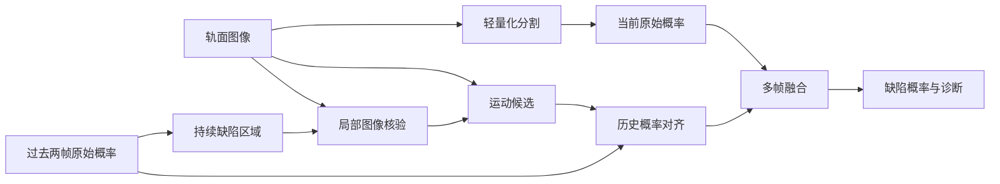

# Rail Surface Motion

**钢轨表面缺陷检测 · 运动补偿 · 多帧融合**

本项目面向移动采集条件下的钢轨表面缺陷检测，研究轻量化分割、帧间配准与历史缺陷证据的协同使用。项目提供MATLAB分割基线与训练流程，以及可接入逐帧概率的Python运动反馈原型。

当前开发版本 v0.6.0。本版本关注何时应让历史帧纠正当前判断。在 12 条由钢轨图像生成的开发序列中，放开局部画质门槛恢复了部分漏检，也引入了更多误报。项目将条件纠错保留为实验分支，供后续真实轨面验证。[方法、结果与复现](docs/algorithm_conditional_gate_study.md)

[快速开始](docs/START_HERE.md) · [方法与实验](docs/algorithm_v3_prototype_results.md) · [研究进展](docs/PROGRESS.md) · [更新记录](CHANGELOG.md)

## 项目特点

- **轻量分割基线**：小型U-Net与MobileNetV2–DeepLabv3+，包含训练、验证和三种子比较。
- **运动补偿**：NCC配准、可选位移先验，以及分离的亚像素运动假设。
- **历史证据核验**：利用过去帧的持续缺陷响应确定图像匹配区域，研究运动反馈与融合可靠性。
- **模块化接口**：`MotionFeedback.step`接收RGB和原始分割概率，输出不同反馈/融合分支的概率及诊断信息。
- **可复现实验**：固定分区、参数与评价口径，配套人工场景、对照方法和结果CSV。

## 方法概览



v3采用三帧因果窗口。历史缺陷区域引导图像核验，运动估计用于对齐原始概率；反馈结果与融合结果分别比较，便于识别各模块的作用。

## 快速开始

```bash
git clone https://github.com/LevinJustus/rail-surface-motion-research.git
cd rail-surface-motion-research
python -m pip install -r requirements-v3.txt

# 运行算法行为检查
python tools/run_v3_feedback_batch.py --contracts-only --out runs/v3_contracts_demo

# 运行重复纹理、短时漏检与错误历史的人工场景
python tools/run_v3_feedback_challenge.py --out runs/v3_challenge_demo
```

示例会生成自己的输入和结果，输出写入`runs/`。更换输出目录名即可保留多次运行记录。接入视频概率、MATLAB训练与数据准备见[快速开始](docs/START_HERE.md)。

## 实验结果

单帧基线采用1396张训练图、400张验证图，结果为三个种子的均值±样本标准差；IoU、Dice为缺陷前景像素指标。

| 模型 | 参数量 | IoU | Dice | Precision | Recall |
|---|---:|---:|---:|---:|---:|
| 小型U-Net | 482050 | 0.4524±0.0364 | 0.6224±0.0342 | 0.5451±0.0973 | 0.7464±0.0713 |
| MobileNetV2–DeepLabv3+ | 2740082 | 0.4408±0.0200 | 0.6117±0.0194 | 0.6314±0.0189 | 0.5933±0.0214 |

完整设置和best/last结果见[单帧基线](docs/step10_full_results.md)与[模型对照](docs/step11_mature_results.md)。

运动反馈实验使用3个钢轨图像来源派生的12条序列，比较单帧、简单衰减、亚像素参照及反馈开关。在这批序列中，v3反馈没有改变运动选择，尚未产生检测增益。人工重复纹理场景既出现成功消歧，也暴露了候选遗漏与误选。详细数据见[v3实验报告](docs/algorithm_v3_prototype_results.md)。


## 项目结构

```text
python/          运动反馈与概率融合接口
matlab/          分割网络、训练、配准与受控序列生成
tools/           数据准备、评价与结果绘图
configs/         模型、训练和运动算法配置
data/            数据来源、文件清单与固定分区
docs/            方法说明、实验报告和研究进展
results/         基线比较、阈值诊断与配准结果
```

## 研究路线

近期重点是钢轨适用性：验证实际采集尺度下的分割输出、连续轨面中的配准与误报，并在确认的表面缺陷视频上检验历史纠错。后续围绕候选覆盖和可靠历史证据开展方法改进。

当前实验以静态图像及其受控派生序列为主；真实连续采集、完整处理效率和端侧部署是接下来的验证任务。路线与报告索引见[研究进展](docs/PROGRESS.md)。

## 数据与使用

数据来源、固定分区和各类实验所需输入见[数据与复现](docs/PUBLICATION_POLICY.md)。第三方材料归属见[THIRD_PARTY_NOTICES](THIRD_PARTY_NOTICES.md)。欢迎围绕使用问题、算法实现和钢轨视频实验提交Issue或Pull Request。
