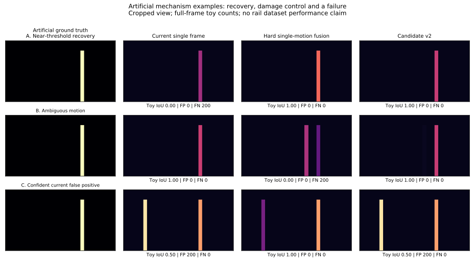

# v2算法介绍与最小实现成果

复现说明：本文保留研究数值和原始SHA；未分发的运行记录链接已省略。当前文档整理不代表重新运行实验。 本文来源文件SHA-256：`06b9839969a08f62ae203160f430ffda0a75606120ca6f769dc1d0a100de7b22`。


日期：2026年11月18日。阶段13E2：最小实现和解析契约已完成。当前成果为可运行核心、公式性质及人工机制演示；未取得v2真实钢轨数据精度或板端实时性结果。

## 算法到底做什么

它接在现有分割网络后面。网络逐帧给出“这个像素属于缺陷的概率”；本算法负责把历史概率搬到当前坐标，并决定该借用多少历史信息。它没有重新训练一个更大的网络。

例如，同一条细裂纹在上一帧和当前帧的位置不同。只选择一个位移时，配准选错可能将裂纹搬到正常轨面，并在平均时抹掉当前裂纹。v2保留多个可能位移，检查它们补偿后的概率是否一致，再决定融合强度。

流程为：**逐帧缺陷概率 → 多候选运动补偿 → 像素级分歧/未知质量风险 → 有限历史更新 → 缺陷概率与掩膜。** 算法输入没有缺陷标签，标签只供独立评价。

## 核心机制与优势的证据等级

| 设计 | 实际含义 | 当前可以确认什么 |
|---|---|---|
| 多位移而非单点 | 重复纹理产生多个合理匹配时，不假装只有一个确定答案 | 候选权重、符号、归一化和RGB链路已检查；真实效果未测 |
| 保留遗漏质量 | 只计算25个候选也不把被截断的运动可能性抹掉；越界作为未知 | 截断不重归一化、路径质量相乘和越界契约通过 |
| 像素风险更新 | 同一运动歧义在平坦背景和细裂纹边缘的影响不同，按补偿后的概率分歧控制更新 | 风险分解及遗漏平方差界检查通过；不是语义错误概率保证 |
| 原始三帧窗口 | 只用当前和最多两帧原始概率，不反复传播已经融合的预测 | 四帧流式检查证明状态只保留三帧原始输入，支持重置和缺测 |
| 无新增训练参数 | 核心是确定的补偿与融合计算，可接已有分割器 | 本轮新增网络前向和优化器更新均为0；候选计算仍有成本，未证明比单点更快 |

最具体的候选贡献是：**将运动歧义、候选截断和视野未知质量，统一传递到缺陷概率更新风险。** 多假设、运动不确定性和概率传播已有前作；本组合机制的独有性和真实收益仍需查重及实证。

## 已经做出的源码和接口

新增六个MATLAB核心：v2_select_motion、v2_motion_weights、v2_compose_motion、v2_history_evidence、v2_fuse_window、v2_compensation_step。另有解析/人工演示入口check_v2_compensation、独立Python核查和标准科研绘图工具。

流式调用示例：

```matlab
addpath('matlab');
cfg = jsondecode(fileread('configs/algorithm_design_v2.json'));
state = []; % 新序列重置
observation = struct('timestamp_s', 0, 'odometry_px', 0, ...
                     'odometry_available', false);
[probability, state, diagnostic] = v2_compensation_step( ...
    rgb_uint8_256x256x3, raw_probability_256x256, observation, state, cfg);
mask = probability >= 0.5;
```

其中RGB和原始概率由调用方提供；该接口自身不加载网络、数据集或标签。时间戳须递增，不同序列传入空state。设计配置SHA仍为5113c09b25b2adf6ae211d7bd37cc0a69871864b5957b36cb414df52e0fdf53d，未为演示调参。

## 一个可推导的性质，以及它的代价

对于单段历史，令a=|历史条件均值−当前概率|。由平方差分解可得R≥qa²。于是：

\[
g a=q a\exp[-R/(2\sigma_R^2)]
\le q a\exp[-q a^2/(2\sigma_R^2)]
\le \sigma_R/\sqrt e.
\]

最多三帧、历史更新系数为1/n，所以未加保护的实数更新满足：

\[
|\Delta|\le\frac{n-1}{n}\frac{\sigma_R}{\sqrt e}
\le\frac{2}{3}\frac{0.25}{\sqrt e}=0.1010884432854389.
\]

这是概率更新幅度界，不是缺陷误差界；存盘single还存在浮点舍入。它限制历史对当前结果的扰动，也限制纠错能力：当前概率低于约0.3989时，默认三帧更新无法把它推过0.5。因此本版较适合研究接近阈值的恢复和错误历史损伤控制，不能宣传为能够救回任意严重漏检。

另一个发现：当前默认σ_R=0.25下，p≥0.7的像素即使受到最大负向更新也不会跌破0.5，因此显式强前景保护钳位实际上不会额外触发。该保护按设计保留，但不能把它当成已产生独立收益的创新模块。解析检查用仅供契约的σ_R=1参数副本确认钳位代码确实可触发；正式默认配置未修改。

## 三个人工机制案例：包括失败

下表数值是人工构造概率图上的像素数，每个案例的真实细条目标为200像素，**不是200处真实钢轨缺陷**。案例位移/歧义由构造给定，用于检查算法行为，不代表NCC在真实纹理中产生同样分布。另有独立的四帧合成RGB链路检查。

| 案例 | 当前单帧 | 单点运动补偿固定融合 | v2 |
|---|---:|---:|---:|
| A：当前缺陷概率0.45，可靠历史概率0.8 | 漏检200像素 | 漏检0 | 漏检0 |
| B：当前能检出，但单点选错位移 | 漏检0 | 漏检200像素 | 漏检0 |
| C：当前把正常区域以0.95误判为缺陷，历史正常 | 误报200像素 | 误报0 | 误报200像素 |

A说明本算法在该构造下仍会利用可靠历史，不是永远关闭历史；A中普通融合同样成功，不能当作v2独有优势。B展示歧义控制的预期行为，也不是相对单帧的精度提升。C直接暴露代价：风险以当前概率为参照，可能拒绝本来能纠正当前错误的历史。本版没有得到全面优于普通融合的结论。



## 已完成的检查与实际产物

v2_minimal_contracts_v1_02完成18项解析检查：候选符号/归一化、缺测回退、错误观测衰减、无纹理/边界拒绝、候选截断、路径权重、遗漏质量、风险分解/界、中间越界、历史不可用、首帧、范围/更新界、默认保护不触发、保护分支、严重漏检边界、RGB流式链路、序列重置、时间戳拒绝。MATLAB阶段墙钟1.7638167秒，包含检查与写文件，不作为推理延迟或FPS。

独立NumPy/SciPy实现从人工RGB重算三个NCC网格及运动权重，重建四帧流式输出、三个案例输出和九行像素计数。最大运动权重差3.6600192107202744e-34，最大float32概率差0，计数全部一致；风险分解MATLAB误差3.0531133177191805e-16。原始图像/网络/验证及保留测试载荷访问均为0。

首轮v1_01在保护分支夹具失败：single(0.7)提升double后为0.699999988079071，小于配置的double 0.7，未进入预期分支。保留原失败及源文件，改用可精确表示的0.75构造该夹具，在新v1_02重跑；核心公式、参数和比较精度不改。绘图首版纵向长标签拥挤，保留旧图，新版改为A/B/C横向案例标题，实际查看后通过。

成果保存为源码、冻结配置、MATLAB检查记录、独立审计、人工案例MAT/CSV、PNG/SVG和本报告。本轮没有训练或启动旧C5队列，也没有GitHub、论文、Word或定时任务更新。

## 下一步

13E2可勾选；下一项13E3只用一个已有检查点、最多12条训练来源序列初筛。保留同整数运动的单点对照和原亚像素强参照，区分整数采样、多候选和风险机制；检查是否仅靠少用历史回到单帧，并统计新增漏检/误报和有用恢复。此后才决定正式实验规模。没有通过真实数据初筛前，不称已经获得可投稿的完整算法成果。
