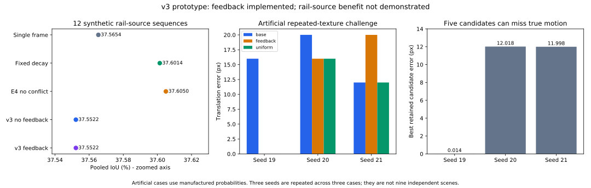

# v3：历史缺陷证据引导运动消歧

2026 年 11 月 19 日。历史缺陷区域可以为运动匹配提供另一处观察位置。原型将它用于候选重排序，但在这批钢轨派生序列上没有观察到额外的检测收益。

## 运动候选与局部核验

`python/rail_motion_v3.py`提供不依赖研究日志、数据目录或网络权重的流式接口。输入为256×256 RGB、前端网络原始分割概率、时间戳及可选观测里程，输出五种对照概率及运动诊断。当前原型使用Python/NumPy/SciPy，复用既有MATLAB训练的U-Net概率，不要求重训分割器或额外训练运动模块。

运动估计分为四步。

1. 在原41×41位移域提取最多5个分开的局部峰，峰间切比雪夫距离至少4像素，每个峰做局部二次亚像素定位。
2. 仅用过去两帧的原始概率，按前一对的基础运动对齐，取持续≥0.5的响应形成历史ROI。ROI扩张2像素，外环扩张8像素；核心和外环各占核验权重的一半。
3. 对每个运动假设，用当前真实图像与历史图像的加权强度相关、梯度一致性核验ROI及外环。以0.1倍图像核验分数对基础运动分数做一次重排序。
4. 重新从原始概率进行保守或强纠错融合，最多使用三帧，不把融合结果存作新观测。

历史缺陷证据决定核查位置，图像对应决定运动重排序，当前分割概率不参与当前运动核验。ROI形成使用基础历史运动，避免不同反馈分支生成不同ROI而混淆对照。没有足够持续响应时回退基础运动。该隔离减少直接自证，不保证历史预测语义正确。

默认值见`configs/algorithm_design_v3.json`，本实验只运行一个事先设定的参数组，没有搜索σ、反馈强度或阈值。基础匹配沿用NCC和可缺失运动先验；候选分数与反馈分数都是启发式，不是校准后验。只保留5个峰可能遗漏真运动，本实验确实观察到该失败。

## 运动核验与融合对照

| 分支 | 位移选择 | 融合规则 | 对照问题 |
|---|---|---|---|
| B | 基础亚像素匹配 | 保守冲突门控 | 保守融合的基础参照 |
| C | 历史缺陷区域核验 | 保守冲突门控 | 与 B 比较历史区域对位移选择的影响 |
| E | 基础亚像素匹配 | 强纠错 | 强融合的基础参照 |
| D | 历史缺陷区域核验 | 强纠错 | 与 E 比较强融合条件下的反馈收益 |
| F | 均匀区域图像核验 | 强纠错 | 与 D 比较缺陷区域和均匀区域的核验效果 |

强纠错对当前帧和两帧历史的原始概率等权融合。某帧历史无效时，其权重留给当前帧。保守分支按历史与当前的分歧衰减历史贡献。各分支均在当前分数 ≥0.7 时将融合分数保在 0.5 或以上，因此高分误报可能延续。D 和 F 在相同帧启用图像核验，共用评分实现，有效核验范围随区域权重与可见性变化。

另外提供 8 个参照，包括单帧、整数 MAP、固定衰减、原亚像素融合、v2 和 E4。反馈的作用由 B/C 和 E/D 的同条件比较估计。

## 同一批钢轨来源派生序列结果

继续使用3个训练来源代理组×4条件、12条序列、108帧，主评价96帧；首种子20261114原始概率缓存不变。新增540份五分支输出，总共1404个方法帧。生产只读取RGB、原始概率及模拟观测；预测冻结、重哈希后才在评价端读取掩膜和准确几何。

| 方法 | 来源宏前景IoU（%） | 汇总前景IoU（%） |
|---|---:|---:|
| 单帧 | 30.5098 | 37.5654 |
| 简单固定衰减 | 30.5679 | 37.6014 |
| E4去冲突项 | 30.5665 | 37.6050 |
| B基础保守 | 30.5353 | 37.5859 |
| C反馈保守 | 30.5353 | 37.5859 |
| E基础强纠错 | 30.5755 | 37.5522 |
| D反馈强纠错 | 30.5755 | 37.5522 |
| F均匀核验强纠错 | 30.5755 | 37.5522 |

**反馈在本批没有改变任何运动选择，因此C=B、D=E=F，检测收益为0。** 96对中84对只有一个合格运动峰，另12对有2—3个峰；84对具备历史ROI，但核验未改变最大候选。不能将未切换简单解释成代码未执行，也不能把更多纠错归给反馈。

基础/反馈/均匀核验的相邻帧中央128×128采样EPE均为0.252339px。该口径不同于E3跨一/两帧全像素的EPE及原13B稀疏网格结果，不作直接排序。保守分支恢复严格历史机会3754/26284（14.28%），强纠错分支12717/26284（48.38%）；强纠错同时相对单帧新增35470个FP、纠正24087个FP，汇总IoU低于单帧。因此历史机会恢复比例上升不代表整体检测更好。

## 重复纹理与错误历史的人工场景

周期纹理可能让中央模板产生多个近似匹配峰。人工场景在第三帧去除非周期背景分量，同时保留模板之外的一部分局部结构，用于观察外部纹理能否支持位移消歧。固定 3 个种子，每个种子共享同一组三帧图像，分别构造重复纹理、当前严重漏检和稳定错误历史三类概率与标签，共 9 条案例、3 组独立图像情境。

| 人工种子后两位 | 基础位移误差（px） | ROI反馈（px） | 均匀核验（px） | 最优保留候选（px） |
|---|---:|---:|---:|---:|
| 19 | 15.9985 | 0.0137 | 0.0137 | 0.0137 |
| 20 | 20.0101 | 15.9989 | 15.9989 | 12.0182 |
| 21 | 11.9978 | 20.0045 | 11.9978 | 11.9978 |

ROI反馈在9条案例均改变运动选择，但一次改变不等于改善：种子21反而变差，种子20/21的正确运动未进入前5候选。均匀核验平均EPE约9.3368px，比ROI反馈约12.0057px更低，尚不支持“缺陷引导”优于通用图像核验。

种子19的人工严重漏检案例可由反馈强融合恢复到完整人工掩膜，而保守融合仍不能恢复；该结果只是机制正例，不能替代真实检测证据。按三个种子合计，重复纹理及严重漏检两类中的D与F均为TP638/FP487/FN487，E为TP263/FP862/FN862。稳定错误历史案例中，E/D/F均向当前正常图像传播1125次FP，单帧为0；图像对齐正确并不能解决语义误报。



## 行为检查与耗时

11项针对性解析检查通过，包括位移符号、中间视野越界、强漏检恢复及错误历史反例、亚像素匹配、峰分离、ROI图像消歧、证据不足回退、当前预测排除、原始缓存及概率范围、时间戳拒绝。旧8方法864行评价与E4精确一致；新方法采用固定0.5阈值统计，未重新调参。

方法批次用时11.1115283秒，含配准、五分支、缓存及文件写入；评价5.5811813秒。人工挑战约1.86秒。没有重新运行分割网络，以上时间不是完整系统时延或FPS；也未实测K230。使用已有Python3.7/NumPy1.15/SciPy1.1环境，未安装依赖；旧SciPy兼容警告保留。

命令行入口使用`os.path.abspath`兼容Python3.7/Windows下尚未创建的输出目录。该调整只涉及路径处理，算法和评价计算保持一致，示例结果经复核一致。

预测索引 SHA-256：`f2640e9ef5aad19b63360ab1e4e94644a6827483680d9e13fdc8b81c7a4ba926`。运行目录为`runs/v3_feedback_batch_v1_01`及`runs/v3_feedback_challenge_v1_01`，结果表见`docs/evidence/algorithm_v3`。模型训练/新前向/验证与保留测试访问均0。

## 运行示例

安装依赖范围见`requirements-v3.txt`；本版本未验证所有现代依赖组合。从仓库根目录运行，不需要钢轨数据或权重：

```text
python tools/run_v3_feedback_batch.py --contracts-only --out runs/v3_contracts_NEW
python tools/run_v3_feedback_challenge.py --out runs/v3_challenge_NEW
```

12条钢轨来源派生序列的批次驱动器读取E3/E4原始概率、图像和评价几何。按[数据与复现](PUBLICATION_POLICY.md)及对应协议准备输入后运行；人工示例独立生成自己的输入。

接入任意分割网络的原始概率：

```python
import sys
sys.path.insert(0, 'python')
from rail_motion_v3 import MotionFeedback
stream = MotionFeedback()
outputs, diagnostic = stream.step(rgb_uint8, raw_probability, timestamp_s=0.0)
probability = outputs['D_feedback_strong']
```

每条新序列重新实例化，时间戳递增；可选`odometry_px`必须为实际观测的图像位移单位，没有标定时不传毫米。该原型尚未完成最终方法选择。

## 结果的适用范围

v3提供可调用的运动反馈实现与相同融合下的对照。当前钢轨来源派生序列未产生反馈增益；人工困难场景暴露候选遗漏、反馈误选及稳定误报传播。

候选覆盖是后续方法重点：真运动不在候选中时，重排序无法恢复。新的候选生成方法将保留相同融合/均匀核验对照，并在真实钢轨连续采集中评价重复纹理、振动、遮挡及正常区域表现。

---

[项目主页](../README.md) · [研究进展](PROGRESS.md)
