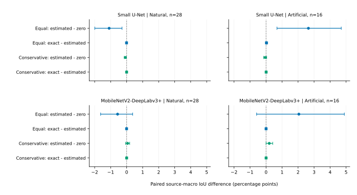

# 准确几何对齐消融

在 44 个保留来源代理组生成的 132 条受控钢轨序列上，固定两种分割前端、三帧窗口、融合规则和 0.50 阈值，分别比较零位移、估计对齐与准确几何对齐。准确几何仅用于离线反事实评价，不进入实际检测器，也不构成可部署的运动测量方法。

准确对齐采用已知的帧间仿射及有效视野，历史概率经双线性插值一次；无效历史回退至当前帧原始概率。主分析使用固定 ROI，严格共同有效视野作为敏感性分析。配对区间按来源代理组重采样 10,000 次。

## 准确对齐与估计对齐

| 前端 / 分区 | 等权准确 − 等权估计 | 保守准确 − 保守估计 |
|---|---:|---:|
| Small U-Net / 自然 | −0.0075 [−0.0126, −0.0026] | −0.0035 [−0.0059, −0.0010] |
| Small U-Net / 人工 | +0.0258 [+0.0084, +0.0451] | +0.0063 [−0.0012, +0.0154] |
| DeepLab / 自然 | −0.0048 [−0.0125, +0.0022] | −0.0016 [−0.0055, +0.0020] |
| DeepLab / 人工 | +0.0017 [−0.0238, +0.0313] | +0.0027 [−0.0073, +0.0127] |

数值为来源宏平均前景 IoU 的百分点变化及 95% 配对区间。将估计替换成准确几何后，总体差异均小于 0.03 个百分点。Small U-Net 人工组的 combined 条件中，准确等权相对估计等权提高 0.0898 个百分点；自然组对应下降 0.0198 个百分点。准确配准并未消除来源差异。



## 历史证据及误差传播

准确几何下，历史可见覆盖约为 96.52%。但在单帧漏检像素中，至少一帧历史原始概率达到 0.50 的观测仅占 Small U-Net 自然/人工组的 2.57%/5.88%、DeepLab 自然/人工组的 4.88%/7.67%。对于缺少前景支持的历史，概率融合可利用的纠错证据有限；现有保守规则还会抑制部分有历史支持的响应。

因此，在本批原 20 Hz 受控序列中，剩余配准误差不是融合性能的主要限制。更好的几何对应并不保证更好的分割；单帧证据、历史前景可靠性及融合权重同样重要。该结果不否定大位移条件下的配准问题——[采样间隔实验](heldout_motion_sampling_results.md#采样间隔与像素位移)中已观察到搜索范围受限与错配。

## 数据与复现

- [方法与验证指标](evidence/heldout_exact_alignment/aggregate_metrics.csv)
- [配对区间和四类错误变化](evidence/heldout_exact_alignment/aggregate_paired.csv)
- [历史覆盖率](evidence/heldout_exact_alignment/aggregate_history_coverage.csv)及[历史纠错机会](evidence/heldout_exact_alignment/aggregate_history_opportunity.csv)
- [退化条件分层图](evidence/heldout_exact_alignment/oracle_by_degradation.svg)
- [聚合图复现脚本](../tools/plot_oracle_alignment.py)

```bash
python tools/plot_oracle_alignment.py --data docs/evidence/heldout_exact_alignment --out runs/oracle_figures
```

实验复核覆盖 9,504 个既有分支掩膜、60 条独立复算的准确历史路径和 416 项配对统计及错误计数。主结论限于冻结前端的受控派生序列；真实有标签连续视频和更广泛物理轨段评价仍是后续研究。
