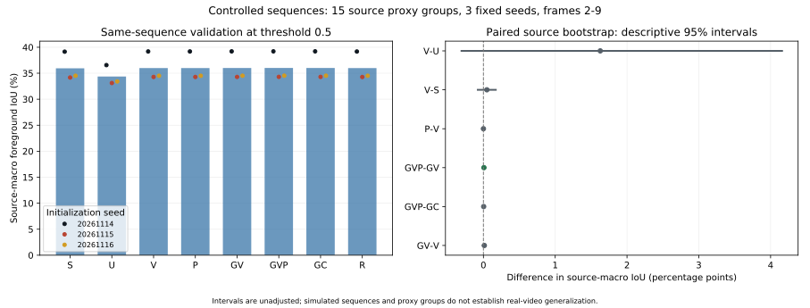

# 多帧融合开发验证

日期：2026年11月18日。状态：完整执行与独立审计通过；13C5消融/鲁棒性和13C6结论审查尚未完成。本报告描述受控派生序列的开发验证，不是独立最终测试、真实视频或硬件部署结果。

## 当前结果

本实验H1/H2/H3均未达到完整冻结判据，不能据此把v1写成已证明稳定提升的核心创新。视觉补偿V相对单帧S的来源宏IoU变化为0.048个百分点，描述性95%区间[-0.079, 0.172]，跨0且种子方向不一致；micro IoU则由32.894%变为32.844%。相对未对齐平均U的点差虽更大，其来源区间也跨0，不能只凭均值宣称补偿稳定有效。

观测先验NCC与纯视觉NCC的输出全部相同。GVP相对GV有极小的正向来源IoU区间，但相对恒定衰减控制GC的差值区间跨0，尚未排除“少用历史”这一解释；新增漏检/误报也需分别看，不能将微小均值变化直接等同于科研贡献。消融与方法修订按独立配置组织，版本进展见[研究进展](PROGRESS.md)。

## 实际范围与冻结顺序

先在原36条训练来源序列上补齐20261115/20261116两个已有检查点的推理与19点阈值校准，并复核MATLAB计数。与13C3首种子的记录汇总后，在任何正式验证载荷推理/掩膜读取前冻结三种子×八方法的24个阈值，配置SHA为`66a21cb635398bf953a1b7e1b2256a7cf20a1f05ca08330ed4d087b47c5aa9a6`；GC仍为0.9597680584784836，门控/窗口/原算法源码不改。

随后对180条验证序列（15来源代理组×12条件×9帧）执行全部三种子/八方法。新增校准前向648次、验证前向4860次，本实验共5508次；累计C3/C4训练来源前向972、验证4860，恰为预定5832个图像-检查点组合。所有优化器更新0，检查点文件/参数/状态保持一致。正式验证输出38880个方法帧，主表帧2—9为34560个方法帧；两阈值条件共77760行计数。派生帧、条件和种子不增加独立来源数。

三个种子的预测均先保存并冻结SHA，才启动验证掩膜评价。算法未读准确几何或掩膜；评价只打开固定验证来源中心时刻掩膜，保留测试载荷0。当前检查点曾由静态验证选出，且物理轨段独立性未核实，因此“正式”指按协议完整执行，不等同于盲测泛化认证。

## 主比较：同一裁剪序列、阈值0.5、帧2—9

| 方法 | 来源宏前景IoU均值±种子SD（%） | micro前景IoU（%） | micro Precision（%） | micro Recall（%） |
|---|---:|---:|---:|---:|
| S 单帧 | 35.947±2.777 | 32.894 | 50.567 | 49.324 |
| U 未对齐平均 | 34.367±1.908 | 32.194 | 50.427 | 47.995 |
| V 视觉补偿固定融合 | 35.995±2.768 | 32.844 | 50.626 | 49.153 |
| P 先验NCC固定融合 | 35.995±2.768 | 32.844 | 50.626 | 49.153 |
| GV 纯视觉门控 | 36.007±2.773 | 32.859 | 50.638 | 49.176 |
| GVP 观测不一致候选 | 36.014±2.769 | 32.863 | 50.650 | 49.175 |
| GC 恒定衰减控制 | 36.011±2.773 | 32.863 | 50.637 | 49.187 |
| R 有限递归视觉参照 | 35.990±2.762 | 32.845 | 50.620 | 49.163 |

主指标为先按来源汇总12条件/8帧，再计算IoU、来源内平均三种子、最后等来源平均。±为三种子样本标准差，不是来源置信区间；micro列为逐种子全局像素指标的三种子均值。背景全空来源数为1，空预测且空真值的IoU按协议记1；非空来源敏感性另列method_summary.csv，不隐藏背景场景。旧静态整图缩放0.4524与本表的视野、尺度、汇总方式不同，不能直接相减当融合提升。

## 来源配对变化与当前假设

| 预定比较 | Δ来源宏IoU（百分点） | 描述性95%区间（百分点） | 来源胜/平/负 |
|---|---:|---:|---:|
| V-U | 1.627 | [-0.306, 4.160] | 8/1/6 |
| V-S | 0.048 | [-0.079, 0.172] | 7/1/7 |
| P-V | 0.000 | [0.000, 0.000] | 0/15/0 |
| GVP-GV | 0.007 | [0.001, 0.013] | 11/1/3 |
| GVP-GC | 0.003 | [-0.004, 0.011] | 10/1/4 |
| GV-V | 0.012 | [-0.008, 0.034] | 8/1/6 |

来源配对bootstrap严格使用PCG64/20261118、10000次/15来源抽样，三种子和全部条件随来源保留。区间为未作多重校正的描述性百分位区间，不使用像素/相邻帧制造显著性，不据不同子条件挑选有利主表。

- H1：未达到本实验描述性规则。要求V同时超过U与S，并披露种子方向；不是只超过未对齐平均就宣称检测改善。
- H2：未达到本实验描述性规则。V/P完全相同方法帧为4860/4860；若全部相同，共同收益不能归给观测先验。
- H3：未达到本实验描述性规则。要求候选相对GV与GC同时改善IoU并减少新增错误，而且两类损伤分别满足冻结规则；不能只选误报减少的一侧。

完整新漏检/新误报、纠正量、区间和各种子方向见[配对表](evidence/step13c4/paired_contrasts.csv)。方法各自训练阈值下的转换不能作为纯融合归因；当前规则核对只用统一0.5。上述为本实验现象，最终证据判断仍需13C5/C6，不代替近邻差异、新颖性、真实视频和最终测试。

## 训练阈值参照与辅助评价

| 方法 | 训练校准后来源宏IoU（%） | 原0.5来源宏IoU（%） |
|---|---:|---:|
| S | 35.975 | 35.947 |
| U | 33.943 | 34.367 |
| V | 35.894 | 35.995 |
| P | 35.894 | 35.995 |
| GV | 35.986 | 36.007 |
| GVP | 35.990 | 36.014 |
| GC | 35.987 | 36.011 |
| R | 35.988 | 35.990 |

所有方法获得相同19点训练内校准预算，验证不选最优阈值；本表各方法/种子使用其冻结训练阈值，不能把与原0.5差值全归给运动补偿。0.5主表、全9帧、满窗口帧3—9、逐来源、12条件和三种子均保留。区域评价按8连通、不删小区域、GT覆盖0.25和预测最大IoU0.1规则，含1—15/16—63/64—255/≥256像素分层；详见component_summary.csv。它是每帧组件统计，不是物理缺陷事件、细裂纹毫米尺寸或每米误报。

## 独立复核与运行问题

MATLAB和Python逐项重现全部77760行TP/FP/FN/TN及四类纠正/损伤，计数恒等式通过；每种子固定首验证来源12条件的帧2/6、合计576个方法帧独立重采样/门控重算，最大float32数值差0。每种子24对双向NCC独立重算，最大差2.79776e-13；全部1440相邻对的V/P还与13B预测逐项核对。此处实现差不是几何EPE。三种子所有14580×3个概率文件在评价前后核验SHA。

另由独立标量汇总器从34560行0.5主计数重建来源指标与24个预定指标比较，显式排序线性插值重算bootstrap区间，最大差6.93889e-18；10000×15抽样索引完全匹配。统计使用Python3.12.14/NumPy2.3.5，PCG64实际运行，未用旧Anaconda不支持的随机接口。该统计入口要求Python≥3.8/NumPy≥1.22，依赖见[统计环境](../requirements-fusion-statistics.txt)，不与旧审计算子环境混用。

首次验证启动在校准表读取处失败，前向0、验证掩膜读取0。原因是JSON记录字段相同但顺序有两种，MATLAB解成cell。只增加read_fusion_calibration在内存排序字段并连接，原阈值JSON/哈希和数值不重写；首种子新run v1_02成功，旧v1_01 failure保留。冻结表所列控制器初版SHA与修复版差异如实记录读取修订，原C3核心源码及科学参数保持原字节；不把工程修复写成方法新版本。

首轮独立审计前两个种子通过后，第三种子seq0567第5帧V的校准阈值0.7出现FP→TN差1像素：旧NumPy将标量阈值压为float32的0.699999988079071，MATLAB结果与保持double标量比较一致。C4评价器显式将已保存float32值提升到float64再与原阈值比较，区域判定同步，0.5主比较不变；模型/概率/阈值均不修改，三个种子在新审计v1_02全部重查通过，旧通过/失败审计保留。[精度修订](evidence/step13c4/threshold_comparison_fix.json)明确发生在评价阶段、已读验证标签之后，评价器修订时间和原冻结协议分别记录。

对三个训练来源、三种子全部456条阈值曲线作独立精度复核，41条曲线计数有变化，最大30像素，来源宏IoU最大差2.93873e-06；24个最优阈值全部保持原值，冻结SHA不变。精确比较曲线另存training_curves_float64.csv，原冻结表内训练诊断分数留作历史，不重写历史或重新选点。旧SciPy/mkl_fft FutureWarning控制台保留。

## 结果文件、限制和下一步

结果包含逐来源统计、配对抽样及图表，CSV可导入Origin，聚合图采用PNG/SVG格式。表格与图见本页结果目录。

本报告评价冻结方法的同条件表现。后续预定消融见[消融计划](step13c5_execution_plan.md)，风险机制诊断及反馈原型见[v2诊断](step13e3_training_diagnostic_results.md)与[v3实验](algorithm_v3_prototype_results.md)。网络重训、最终保留测试、真实视频、完整效率与K230评价分别安排。

---

[项目主页](../README.md) · [研究进展](PROGRESS.md)
