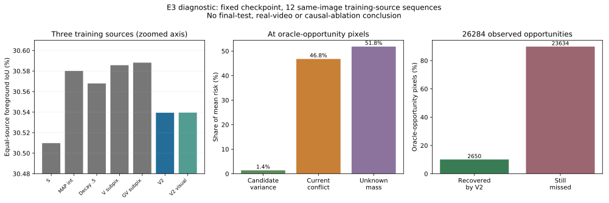

# v2：历史证据与风险诊断

日期：2026年11月19日。本报告分析固定v2在训练来源派生序列上的历史机会、候选覆盖和风险构成；原算法核心与设计参数保持不变。

## 结论

v2在本批来源上的改善很小，未超过简单固定衰减或原视觉门控参照，尚不支持扩大实验。证据不足、当前冲突惩罚和未知质量惩罚同时存在，不能只凭风险分量大小宣称某项为唯一根因。

历史纠错机会确实存在，但只覆盖本诊断定义下当前漏检的3.83%；其中71.51%低于默认更新公式最宽松的恢复下界。v2仅恢复其中10.08%。多候选并未在本批数据中普遍退化到零贡献：平均已知质量约0.785，平均门控约0.458；但较旧历史的路径质量损失更明显。

当前冲突项的作用通过[单因素消融](step13e4_conflict_ablation_results.md)进一步检验。运动反馈另以独立版本实现，避免把风险变更与反馈作用混为同一贡献。

## 固定范围与输入隔离

采用原首种子20261114检查点及已冻结概率缓存，零新增网络前向、零训练更新。12条序列来自3幅训练来源代理组，每组固定clean、geometric_jitter、blur_3px、combined四个既有条件；选择在新标注/机会分析之前冻结，未按本实验证益筛样本。

冻结配置为configs/v2_screening_v1.json，SHA-256为4a900159116500cc20e34380e603ecf4fe8fc4cce92c292e0a8198a8e758e729。v2设计配置SHA仍为5113c09b25b2adf6ae211d7bd37cc0a69871864b5957b36cb414df52e0fdf53d。完整选择为seq0061/0063/0065/0072、seq0373/0375/0377/0384、seq0421/0423/0425/0432。

先由run_v2_screening仅用RGB、模拟观测与已缓存原始概率生成并冻结108帧/7方法/756个方法帧索引，才启动计数和几何诊断。原检查点字节身份再次核验，但不加载网络。准确几何、缺陷掩膜和源分组不传入待测v2；评价单独读取108个训练掩膜和12份几何文件。验证/保留测试载荷0。

本批仍是同图受控派生序列，不是真实连续视频；四条件、相邻帧和检查点不增加独立来源数。检查点过去曾由静态验证选择，本实验只是开发诊断，不能称为盲测或泛化证明。

## 同条件比较

主比较统一0.5阈值、帧2—9，共96帧；来源宏IoU先汇总每来源32帧后计算，再等权平均三个来源。micro列直接汇总像素计数，两种汇总不能混用或挑有利口径。

| 方法 | 来源宏前景IoU（%） | micro前景IoU（%） | 纠正漏检像素 | 新增漏检像素 | 纠正误报像素 | 新增误报像素 |
|---|---:|---:|---:|---:|---:|---:|
| 单帧S | 30.5098 | 37.5654 | 0 | 0 | 0 | 0 |
| 同候选MAP整数单点固定融合 | 30.5801 | 37.5455 | 13496 | 14520 | 37054 | 35773 |
| 同整数单点、历史贡献乘0.5 | 30.5679 | 37.6014 | 5558 | 5121 | 14454 | 13009 |
| 原亚像素视觉固定融合 | 30.5857 | 37.5507 | 13320 | 14055 | 36337 | 35445 |
| 原亚像素视觉门控 | 30.5881 | 37.5673 | 11017 | 11459 | 29825 | 28512 |
| v2 | 30.5394 | 37.5964 | 3177 | 2560 | 7187 | 6584 |
| v2关闭里程先验 | 30.5395 | 37.5982 | 3091 | 2421 | 6923 | 6327 |

v2相对单帧净少617个FN、603个FP，micro IoU增加约0.0310个百分点；但固定衰减micro IoU更高，原视觉门控的来源宏IoU也更高。v2相对S在三个来源中两正一负，其中一个来源的S IoU仅约2.36%，提示分割器/裁剪域本身存在强失败，尚未进一步定位。

去里程先验没有降低本批汇总结果，不能声称运动先验获得独立增益。整数MAP采用与v2相同候选的首个最大权重点；亚像素参照沿用原C3审核过的输出，不据差异把采样精度和多候选机制混为同一贡献。没有进行显著性检验或用三个来源作强泛化主张。

## 历史是否真的有可用证据

评价端按准确几何把过去最多两帧概率双线性采样到当前坐标，历史掩膜最近邻采样；所有中间视野均要求有效。机会定义为：当前GT缺陷被S漏检，至少一帧准确对齐的历史概率≥0.5，且该历史位置也属于历史GT缺陷。

- 当前漏检像素观测：685596。
- 符合上述定义的历史纠错机会：26284，占3.8337%。
- v2恢复的机会：2650，占机会的10.0822%。
- 机会中低于约0.3989的当前概率：18797，占71.5150%；该部分不可能仅靠默认v2更新跨过0.5。

这里的“像素观测”在相邻帧间有关联，不是独立缺陷事件。准确几何仅用于回答历史证据是否存在，不能传给待测算法，也不能把机会数量称为可部署精度上界。

按当前概率分层时，低于约0.3989的FN没有被v2纠正；全部3177个FN纠正都发生在更接近阈值的区间，符合既有更新界。3177并不等于上述2650，因为严格历史机会定义还要求历史GT和准确几何支持；其他纠正可能受不同采样/混合影响，不能全部归类为可靠历史恢复。

## 候选与风险诊断

对准确几何可见的历史像素，保留路径中至少一个候选的采样误差在1像素内的比例为94.31%，2像素内为99.46%；在机会区域的对应1像素覆盖约89.80%。这是候选集合覆盖，不能当成加权融合已选择正确运动。

本批整数MAP平均采样EPE约0.604像素，原亚像素参照约0.566像素，统计包含一帧及两帧历史、所有有效当前坐标。它不同于原13B的相邻帧稀疏网格口径，不与旧0.172px直接比较。当前结果提示大部分位置已有接近正确的候选，反馈的实际提升空间仍需针对歧义区域验证。

一帧历史的平均保留路径质量约0.9523，两帧历史约0.6769。包含视野损失后的所有历史像素平均q=0.7853、g=0.4580；q<0.1约4.64%，g<0.01约15.99%。本批不支持“多数时候几乎完全关闭历史”的强表述，但确有旧历史质量损失。

在机会区域，风险均值的组成约为：候选内部方差1.38%、当前冲突46.78%、未知质量51.84%。未知质量同时包含截断与视野损失；不能把它全归给25候选上限。风险按历史—当前像素对统计，可能重复同一当前像素；比例不是独立样本频率，也不证明删除某项一定提高精度。

## 实现、复核与结果文件

新增范围限于准备/冻结、输入侧运行器、独立计数、独立诊断和聚合绘图；六个v2核心与原配置不修改。MATLAB预测阶段墙钟30.203508秒，独立Python诊断约40.10秒；均含缓存读取、审计及文件输出，不是系统FPS或端到端时延。

MATLAB与Python逐项核对全部756行TP/FP/FN/TN与纠正/新增错误。独立FFT重算192个有/无里程候选选择，独立重建v2两分支和整数参照等432个概率输出，最大float32误差0。另用独立标量汇总核对21条来源指标和方法汇总，并通过准确几何采样的平移符号、90度旋转/标签及中间越界三个解析契约。

结果表位于`docs/evidence/step13e3`，包括方法、来源、历史机会、候选覆盖和风险统计。运行使用既有网络概率，无新增训练或网络推理。

## 消融设计

本诊断提出以下单因素消融，用于检验当前冲突惩罚的影响：

\[
R_{\mathrm{no\ conflict}}=q\operatorname{Var}(h)+(1-q)\max\{p_t^2,(1-p_t)^2\}.
\]

消融只去掉相对当前概率的偏差项，其余候选、未知质量、σ、窗口、输入、阈值和保护规则保持一致。旧v2的0.101更新界与新风险定义分别检查。

消融保持原候选与其他参数，通过同条件纠错、新增错误和来源统计判断作用。结果见[冲突项消融](step13e4_conflict_ablation_results.md)；相同强融合关闭反馈的对照见[v3实验](algorithm_v3_prototype_results.md)。

---

[项目主页](../README.md) · [研究进展](PROGRESS.md)
