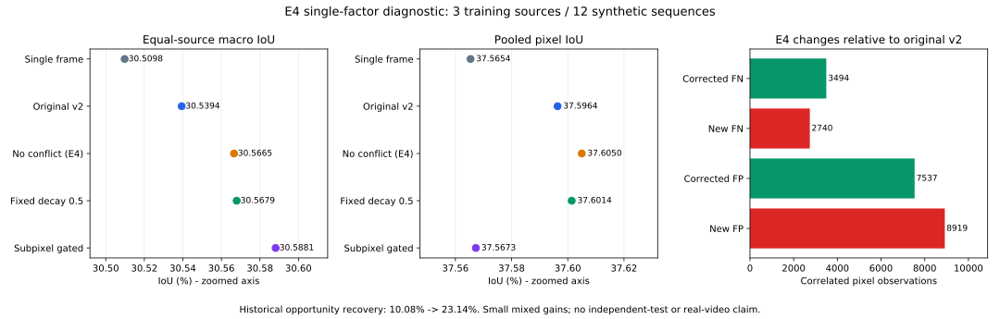

# v2：当前冲突项消融

日期：2026年11月19日。状态：本项实验与独立核验完成；未通过最终算法有效性或创新验证。

## 结论

去掉当前冲突惩罚后，严格历史机会恢复从2650/26284（10.08%）增加至6083/26284（23.14%）。这支持“该项会阻碍部分正确历史纠错”的具体判断，但不支持直接将修改版确定为最终算法。

相对原v2，漏检净减少754次像素观测，误报净增加1382次。汇总IoU仅增加0.0086个百分点；来源宏IoU仍低于简单固定衰减和原亚像素门控。三个来源两正一负，模糊条件退化。解除冲突惩罚提高了更新能力，也放大了错误历史的影响；需要解释新增错误，不能把更大更新直接等同于更好检测。

## 实验设置与风险变更

本实验采用单因素消融。原v2六个核心与设计配置保持原字节；新增独立入口`v2_no_conflict_fuse_window.m`，仅将历史风险从

\[
R=q\operatorname{Var}(h)+q(\bar h-p_t)^2+(1-q)\max\{p_t^2,(1-p_t)^2\}
\]

改为

\[
R_{\mathrm{E4}}=q\operatorname{Var}(h)+(1-q)\max\{p_t^2,(1-p_t)^2\}.
\]

候选、权重、截断、未知质量、σ=0.25、三帧窗口、每历史1/n更新系数、当前强前景保护与0.5阈值完全保持。复用E3已冻结的精确双精度运动候选与原始概率，不重估运动、不反馈分割结果、不递归缓存融合输出、不重新训练或调参。

原v2的约0.101更新界来自公式，不是独立硬限幅器。新分支不适用此界，另检查凸组合范围与绝对更新≤(n−1)/n；原核心及旧界检查不删除。原强前景保护在新分支变得可触发，主评价中1033次像素观测被保护；这是保留同一保护规则的结果，没有另增机制。

事前冻结配置`configs/v2_conflict_ablation_v1.json`的SHA-256为`7d13f3a3a0b3ca4e6f5011069afe5aee4801d319fe73972edb471c2542f6f5a4`。原设计配置SHA仍为`5113c09b25b2adf6ae211d7bd37cc0a69871864b5957b36cb414df52e0fdf53d`。E3的7个对照输出保持相同字节。

## 数据和评价条件

与E3完全相同的首种子20261114检查点缓存、3个训练来源代理组×4条件（clean、geometric_jitter、blur_3px、combined）、12条序列、108帧。序列名单沿用E3，不按本实验成绩替换来源。主评价统一帧2—9，共96帧；首帧只检查恒等行为。

新增108份消融概率，与756份既有方法帧构成864份冻结引用。生产进程只读原始概率和运动候选；全部引用重哈希后，独立评价进程才读取108份训练掩膜和12份准确几何。几何仅用于机会诊断，未输入算法。验证/保留测试载荷访问0，新增网络前向和优化器更新均0。

同图派生帧、像素与条件相互关联；独立来源只有3个。本实验不作显著性检验、不证明真实视频泛化，也不将像素观测计为缺陷事件。

## 同条件结果

来源宏IoU先按每来源32帧汇总再等权平均三个来源；汇总IoU直接累加全部像素计数。两种口径同时保留。

| 方法 | 来源宏前景IoU（%） | 汇总前景IoU（%） | Precision（%） | Recall（%） |
|---|---:|---:|---:|---:|
| 单帧S | 30.5098 | 37.5654 | 50.2056 | 59.8725 |
| 整数MAP固定融合 | 30.5801 | 37.5455 | 50.2122 | 59.8125 |
| 整数MAP固定衰减0.5 | 30.5679 | 37.6014 | 50.2520 | 59.8981 |
| 原亚像素视觉固定融合 | 30.5857 | 37.5507 | 50.2097 | 59.8295 |
| 原亚像素视觉门控 | 30.5881 | 37.5673 | 50.2272 | 59.8466 |
| 原v2 | 30.5394 | 37.5964 | 50.2356 | 59.9086 |
| 原v2关闭里程先验 | 30.5395 | 37.5982 | 50.2367 | 59.9117 |
| 去冲突项E4 | 30.5665 | 37.6050 | 50.2199 | 59.9527 |

E4汇总IoU比固定衰减高约0.0036个百分点，但来源宏IoU低约0.0014个百分点；不能凭极小差异及不同汇总排序宣称稳健胜出。原亚像素门控的来源宏IoU仍最高。E4相对S的汇总IoU增幅约0.0396个百分点，尚不构成有力创新证据。

### 纠正与新增错误

以下均相对同一单帧S、统一0.5阈值：

| 方法 | 纠正FN | 新增FN | 纠正FP | 新增FP |
|---|---:|---:|---:|---:|
| 原v2 | 3177 | 2560 | 7187 | 6584 |
| 去冲突项E4 | 6661 | 5290 | 14689 | 15468 |

直接以原v2输出为参照时，E4纠正3494个FN、新增2740个FN，纠正7537个FP、新增8919个FP，故净少754个FN、净多1382个FP。不能只比较纠正数量而省略新增错误；各类错误代价也未由本实验确定，不能仅将所有净像素数相加决定工程价值。

### 历史机会与较强漏检

严格机会沿用E3：当前GT缺陷被S漏检，准确几何及中间视野有效，至少一帧历史预测≥0.5且该历史位置GT为缺陷。总数固定26284。E4恢复6083（23.14%），原v2恢复2650（10.08%）。

| 当前原始概率 | 当前FN观测 | 严格机会 | 原v2纠正FN | E4纠正FN | E4恢复严格机会 |
|---|---:|---:|---:|---:|---:|
| [0,0.1) | 554459 | 2654 | 0 | 20 | 20 |
| [0.1,0.3) | 82237 | 10247 | 0 | 247 | 246 |
| [0.3,约0.3989) | 24182 | 5896 | 0 | 1271 | 1264 |
| [约0.3989,0.5) | 24718 | 7487 | 3177 | 5123 | 4553 |

E4确实纠正了1538次低于原恢复范围的FN观测，其中1530次符合严格机会定义；原v2在该范围均未纠正。但多数极低概率漏检仍未恢复，剩余未知质量惩罚、历史证据质量等作用没有在本实验拆分。

准确几何诊断的另一集合是当前S正确背景、历史存在GT为背景但预测前景的位置，共83892次像素观测。原v2在其中产生5955次误报，E4为14707次。此集合与误报增长相符，但只是错误历史关联诊断，不能把所有新增误报都归因于此，或称其为因果分解。

### 分来源和条件

三个来源按短编号标识，完整来源ID与映射见安全CSV：

| 来源 | S IoU（%） | 原v2（%） | E4（%） |
|---|---:|---:|---:|
| 510b_1_0 | 49.3754 | 49.4137 | 49.4199 |
| 511b_0_0 | 2.3567 | 2.3511 | 2.3384 |
| 512b_0_1 | 39.7973 | 39.8534 | 39.9414 |

相对v2和S均为两正一负。低IoU来源仍退化，没有换源或重训来掩盖结果。按条件汇总，E4相对v2在几何抖动和综合扰动提高，在clean与blur_3px下降；不能宣称全面提高模糊鲁棒性。

## 实现与核验

新增单独融合入口、9项MATLAB解析契约、计划冻结、缓存生产、MATLAB计数、独立Python重建与聚合图工具。解析契约覆盖：首帧恒等、强漏检恢复、旧v2界仍成立、稳定错误历史导致FP、缺测恒等、越界恒等、保留当前强前景保护、保留截断质量惩罚、保留候选方差。

所有9项通过；MATLAB与Python的864行TP/FP/FN/TN及纠正/新增错误精确一致。Python从原始概率和原候选独立重建108份E4输出，最大float32误差0；原7方法756行与E3精确一致。另用标量逐行复算方法汇总和24行来源统计，通过。原6核心与配置SHA保持不变。

生产墙钟7.150192秒，MATLAB计数3.8700221秒，Python复核17.5905044秒；均包含缓存和文件核查，且运动、网络推理复用，不能作为完整系统FPS或端侧时延。新分支实际最大未保护更新约0.46536，125364次主评价像素观测超过旧公式界，符合公式变化，不是违反原v2检查。

运行目录为`runs/v2_conflict_*_v1_01`，结果表见`docs/evidence/step13e4`。实验复用既有概率，无新增训练或验证/保留测试数据使用。

## 后续研究

本实验将E4保留为独立消融分支：它增加了历史纠错能力，也放大了错误历史的影响，当前结果尚不足以支持替换原v2。

后续分析聚焦新增FP与恢复FN的历史证据及候选混合关系，重点覆盖低IoU来源和模糊条件。运动反馈在独立的[v3实验](algorithm_v3_prototype_results.md)中比较，保留相同融合及均匀核验参照。

---

[项目主页](../README.md) · [研究进展](PROGRESS.md)
